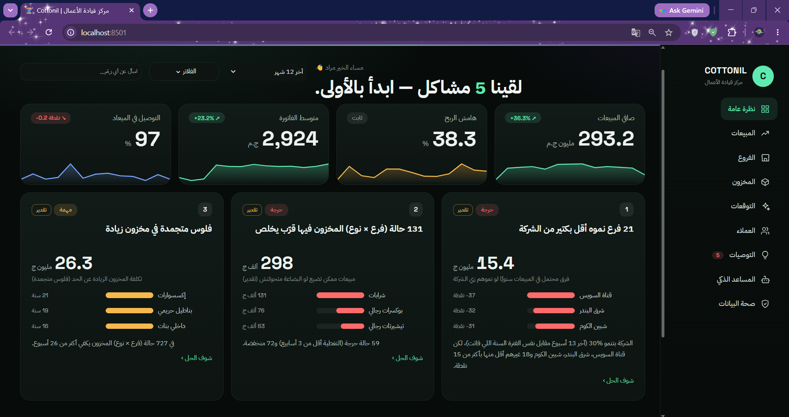

<div align="center">

<br>

[](https://cotonil.streamlit.app/)

### مركز قيادة الأعمال · Arabic Business Intelligence

<br>

[](https://python.org)
[](https://cotonil.streamlit.app/)
[](https://pandas.pydata.org)
[](https://plotly.com)
[](https://groq.com)
[](RELEASE_REPORT.md)

<br>

> **From business records to measurable decisions — in Arabic.**

> **Every number is calculated locally. AI explains — it never invents figures.**

<br>

| 🖥️ Interface | 📊 Analytics | 🤖 AI | 📈 Forecasting | 🗄️ Data | ✅ Release |
|:---:|:---:|:---:|:---:|:---:|:---:|
| **Arabic · RTL · Dark** | **Pandas · Plotly** | **Groq + evidence review** | **12-origin backtesting** | **Authorized datasets** | **260 tests passed** |

<br>

## [🚀 Try the Live Demo →](https://cotonil.streamlit.app/)

<sub>[cotonil.streamlit.app](https://cotonil.streamlit.app/)</sub>

</div>

---

## ✦ Dashboard Preview

<p align="center">
  <a href="https://cotonil.streamlit.app/"></a>
</p>

<p align="center"><sub>Screenshot snapshot — figures are illustrative, not live results. <a href="https://cotonil.streamlit.app/">Open the live app</a> to explore.</sub></p>

---

## ✦ What Is Cottonil BI?

Cottonil BI is a local Streamlit application for exploring retail performance. It connects sales, branch profitability, inventory coverage, customer analysis, and recommendations in an Arabic dashboard.

The assistant resolves Arabic requests into evidence domains, gathers facts with local analytical tools, and keeps the latest answer and its decision options for referenced follow-ups. Groq is used for reviewed interpretation of strategic single- or multi-domain requests when configured; deterministic tools remain the source of business numbers, dates, and scope.

---

## ✦ What's Inside

| Page | Purpose |
|:---|:---|
| Overview | Sales KPIs, trends, and prioritized business issues |
| Sales | Branch, governorate, category, product, and channel analysis |
| Branches | Branch comparisons and profitability where expense data is available |
| Inventory | Stock coverage, shortage/overstock signals, suggested transfers |
| Forecasting | Company, category, branch, and product forecasts with measured uncertainty |
| Customers | RFM segments, purchasing history, and model-quality disclosures |
| Recommendations | Evidence, proposed actions, and clearly labeled estimated impact |
| AI Assistant | Arabic questions, period comparisons, profit analysis, and follow-up context |
| Data Health | Data-quality findings, model diagnostics, and explicit rebuild controls |

Filters apply according to each page's stated scope. Recommendations and forecasting are not automatically restricted by every sales-page filter.

---

## ✦ How the Assistant Works

| Step | What happens |
|:---|:---|
| **1. Understand** | Resolve the requested measures, entities and connected evidence domains before splitting independent operations; selected branches remain bound across dependent evidence |
| **2. Keep context** | Preserve the latest structured answer, scope, source and decision options; follow-ups refer to that answer, while explicit new topics route independently |
| **3. Calculate** | Local modules calculate every business value from the selected records; model output never supplies totals, rankings or measured changes |
| **4. Explain** | Groq drafts conditional interpretations from the relevant local evidence and a separate review checks the result; unsupported or unavailable analysis is not presented as completed |
| **5. Decide and disclose** | Evidence-backed local options remain available as fallback and are retained for follow-up measurement; operational priority is not presented as measured ROI |

Profit value in assistant answers means **sales profit before payroll and operating expenses**, unless another measure is explicitly stated. It is different from profit-margin percentage.

Example prompts — actual results depend on the available data:

```text
قارن مبيعات محافظة الإسكندرية آخر 60 يوم بالـ60 يوم اللي قبلهم.
عايز القيمتين والفرق بالجنيه والنسبة وأكتر 3 فروع أثرت على التغيير.

طيب والربح في نفس الفترة؟ عايز قيمة الربح في الفترتين والفرق
بالجنيه والنسبة وأكتر 3 فروع أثرت عليه. متجيبليش هامش الربح.

اختار أضعف فرعين من حيث نمو المبيعات خلال آخر 12 شهر،
وقارن أداء كل فرع بمخزونه وخصوماته وهامش ربحه.
اقترح خطتين مختلفتين، واحدة لكل فرع، وحدد أولوية التنفيذ وليه.
```

The assistant supports common Arabic wording and uses a local fallback when a request cannot be safely interpreted; arbitrary phrasing is not guaranteed. Review the displayed metric, dates, scope, and source. Relative dates use the **last date in the dataset**, not necessarily today. Requests for the last N months use calendar-month offsets ending at the last recorded date.

---

## ✦ Forecasting

- Forecasts are available at company, category, branch, and product levels.
- Temporal backtesting uses 12 origins, selecting on older periods and evaluating on later ones.
- Revenue is derived from expected quantity and price, with a configurable January price-increase assumption.
- Forecast intervals, historical average error, and reliability labels are separate indicators; none guarantees future accuracy.
- The current incomplete month can be estimated explicitly. Results change when the authorized dataset is rebuilt.

---

## ✦ Quick Start

Python 3.13 is the validated release interpreter. Use `requirements.lock` in an isolated environment; `requirements.txt` retains the development minimum versions.

```bash
git clone https://github.com/morad-elnahla/HVIA_Cottonil.git
cd HVIA_Cottonil
python -m venv .venv
```

Activate the environment:

```powershell
# Windows PowerShell
.venv\Scripts\Activate.ps1
```

```bash
# macOS / Linux
source .venv/bin/activate
```

Install and start:

```bash
python -m pip install -r requirements.lock
streamlit run app.py
```

Open [localhost:8501](http://localhost:8501).

**The repository includes the owner-approved processed dataset and saved forecasts.** A Git checkout runs without uploading or rebuilding data. Raw source files and credentials remain excluded. Source-only delivery ZIPs still omit data unless the explicit data-inclusion option is used.

---

## ✦ Environment & Groq

Groq is optional. Local analysis works without an API key.

Copy `.env.example` to `.env` only if `.env` does not already exist. Add your own key locally; never commit it.

```dotenv
LLM_API_KEY=
LLM_MODEL=openai/gpt-oss-120b
LLM_NARRATE=auto
LLM_TPM_LIMIT=7000
```

| Setting | Purpose |
|:---|:---|
| `LLM_API_KEY` | Your private Groq key; leave empty for local-only operation |
| `LLM_MODEL` | Model identifier; must be available to your account |
| `LLM_NARRATE` | `auto`, `on`, or `off` for optional narrative summaries |
| `LLM_TPM_LIMIT` | Local token-budget guard; does not override provider limits |
| `LLM_ENABLED` | Set `false` to disable external LLM calls |
| `LLM_BASE_URL` | Optional endpoint override; default `https://api.groq.com/openai/v1` |
| `LLM_PLANNER_MODEL` | Optional separate planning model |
| `LLM_TIMEOUT`, `LLM_MAX_RETRIES`, `LLM_MAX_WAIT` | Request timeout and retry controls |

`src/llm.py` reads `.env`; existing environment variables take precedence. Restart Streamlit after configuration or assistant-code changes to clear old cached objects. `BI_USER_NAME`, set in the launch environment, changes the greeting.

When enabled, Groq receives the question, relevant conversation context, and selected calculated results for optional summaries. Use only data permitted for that service. Local diagnostics are written under `logs/`; logs are excluded from GitHub and delivery archives.

---

## ✦ Data & Rebuilding

There are two supported local setups:

1. Place a complete, authorized processed bundle in `data/processed/` to open the dashboard directly.
2. Supply authorized source CSV files under `data/raw/`, then rebuild explicitly:

```bash
python -m src.data
```

The same rebuild is available on **Data Health**. It rebuilds derived data and models and may take around four minutes, depending on the machine and dataset. **It is not required for every startup.**

Core source tables are `sales_orders`, `sales_order_items`, `branches`, and `products_catalog`. Additional source tables support inventory, customers, returns, payroll, and deliveries. Processed forecasts require `forecast.parquet`, `fquality.parquet`, and `backtest.parquet`; the delivery script validates the complete processed bundle when inclusion is requested.

Raw data, processed data, customer records, local metadata, credentials, and logs are not published in this repository. Missing payroll or unreliable source fields can limit profitability and other analyses; read the in-app quality notes. Customer-model quality and forecast uncertainty should not be treated as guaranteed predictions.

---

## ✦ Private Delivery ZIP

The script uses only Python's standard library and a fixed file allowlist. It preserves the folder layout, validates the selected files, checks for common credential patterns, and verifies ZIP integrity. It does not rebuild data, train models, call APIs, or change application code.

```bash
# Source-only ZIP on your Desktop (safe default; business data supplied separately)
python package_delivery.py

# Approved private delivery: includes the complete existing processed bundle
python package_delivery.py --include-processed --confirm-data-sharing

# Inspect the selection without creating a ZIP
python package_delivery.py --include-processed --confirm-data-sharing --dry-run
```

Windows Desktop redirection, including OneDrive, is respected. `--output-dir PATH` optionally overrides the destination. Archives include a `Cottonil_BI/` top-level folder and a delivery note. Raw data, `.env`, logs, caches, virtual environments, and ad hoc API utilities are never included. Offline regression tests and release checks are included. No ZIP is uploaded to GitHub.

**Only use the data-inclusion option when all processed files are approved for the specific recipient.** Processed data can still contain private customer and commercial information. A source-only ZIP is not a populated, data-ready dashboard.

---

## ✦ Project Structure

```text
HVIA_Cottonil/
├── app.py                    # Streamlit entry point and pages
├── requirements.txt          # Runtime dependencies and existing test dependency
├── requirements.lock         # Exact versions validated in isolated Python 3.13
├── README.md
├── DEPLOYMENT.md             # Private-host setup, container option and rollback
├── RELEASE_REPORT.md         # Test evidence and remaining limits
├── release_check.py          # Offline startup preflight
├── live_acceptance.py        # Real Groq check, explicit --live opt-in
├── Dockerfile                # Optional Linux container; see verification limits
├── .env.example              # Empty key; safe configuration template
├── .gitignore
├── package_delivery.py       # Allowlisted private-delivery ZIP builder
├── .streamlit/config.toml    # Dark theme and Streamlit settings
├── photo/1.png               # Dashboard preview
├── src/
│   ├── assistant.py          # Intent parsing, context, and grounded answers
│   ├── llm.py                # Groq client, retry handling, and local budgets
│   ├── health.py             # Analytical impact of existing data-health checks
│   ├── data.py               # Loading, source processing, quality checks
│   ├── metrics.py            # Business metrics and change attribution
│   ├── models.py             # Forecasting and customer models
│   ├── inventory.py          # Coverage and transfer logic
│   ├── insights.py           # Recommendations
│   └── ui.py                 # Shared presentation helpers
└── tests/                   # Offline regression, app, transport and release checks
```

`data/`, `logs/`, and `.env` remain local and are ignored by Git.

---

## ✦ Release Status & Validation

The release candidate includes an exact dependency lock, offline regression tests,
a read-only preflight, a complete source archive, and deployment instructions.
See [RELEASE_REPORT.md](RELEASE_REPORT.md) for measured results and outstanding host checks.

**Verified on 2026-10-31:** 260 tests passed in an isolated Python 3.13.13
environment; two model-training/selection tests were deliberately excluded.
Checks include all nine Streamlit pages, raw-data financial reconciliation,
topic transitions, negation, branch selection, calendar periods and independent
branch plans. A real Groq run of the two-branch manager question completed with
two selected branches, two locally evidenced plans and no split answer parts.
Passing mocked tests is not treated as proof of a live connection.

For compound analysis, factual comparisons are computed locally. Groq generates
conditional interpretations and a proposed plan, followed by an independent
review against the same evidence. Generated prose may not add quantities,
including quantities written as Arabic words, or restate ranked branch claims.
The local comparison table owns those facts. If either stage fails, the response
states that only local evidence is available; it never presents an unchecked draft.
For per-branch decisions, evidence-based local plans remain available even when
AI interpretation is unavailable. Priorities are operational, not a guaranteed
ROI ranking or an optimized budget allocation.

Deploy privately or behind an authenticated HTTPS gateway. This repository does
not provide application login or claim that arbitrary questions are always understood.

---

<div align="center">

### [🚀 Open Cottonil BI Live](https://cotonil.streamlit.app/)

<br>

**Built by [Morad Elnahla](https://github.com/morad-elnahla)** · ⭐ Star the repo if you find it useful


</div>
